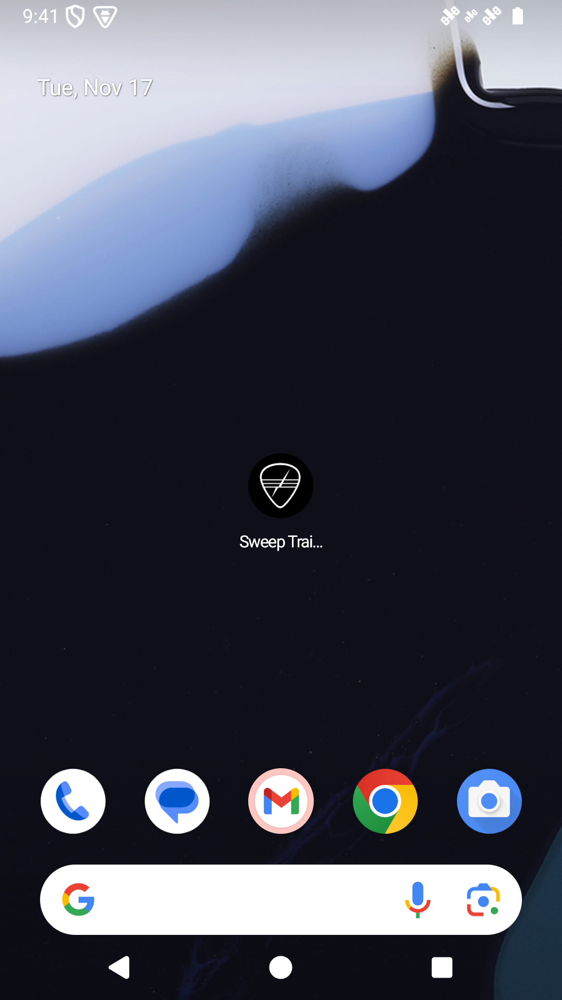
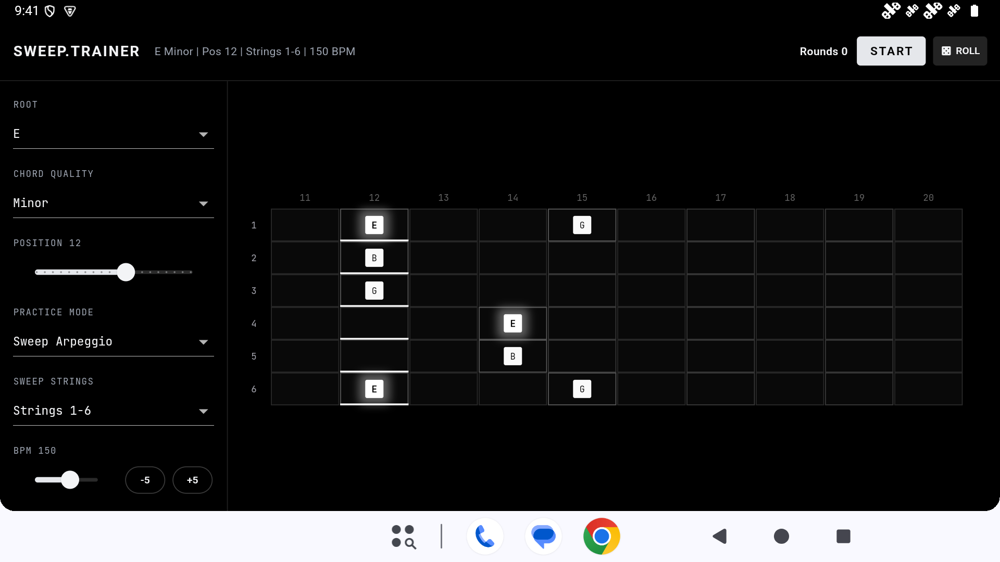
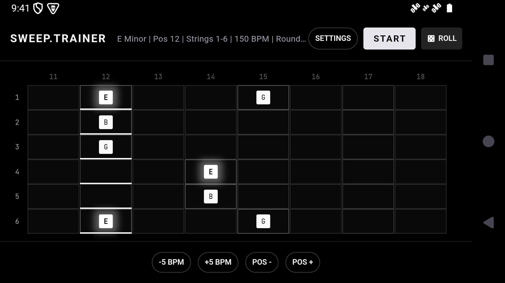

<p align="center">
  
</p>

# Sweep Trainer

A landscape-first Flutter app for guitar sweep-picking and strict three-notes-per-string (3NPS) practice.

Choose a root, chord quality and fretboard position—or press **ROLL** for a playable random combination—then press **START** to practice with generated plucked-note audio and a metronome.

## Download

[Download Sweep Trainer v1.0.0 for Android](https://github.com/musca1997/sweep-trainer/releases/download/v1.0.0/Sweep-Trainer-1.0.0-android.apk)

The universal APK supports ARM64, ARMv7 and x86-64. See the [release notes](https://github.com/musca1997/sweep-trainer/releases/tag/v1.0.0) for signing details and known limitations.

## Screenshots

Real screenshots of the Android Release APK running in an Android phone emulator (not a physical device). The launcher image shows the installed app icon; the in-app layout adapts to the available logical screen width.

### Android home screen

<p align="center">
  
</p>

The launcher icon includes Android adaptive-icon resources with padding for system masks. The displayed app name is **Sweep Trainer**.

### Wide landscape layout



### Compact landscape layout



## Features

- Landscape orientation with a dark interface.
- Sweep arpeggios and strict 3NPS patterns.
- Twelve chromatic roots and Major, Minor, Dominant 7 and Minor 7 qualities.
- Selectable string range, including seven-string low-B tuning.
- Enlarged fret cells and a viewport that automatically follows the selected position.
- A fixed string-number column and centered note markers.
- Low-latency playback through `flutter_soloud`, using generated WAV samples.
- Metronome, rhythmic subdivisions and configurable automatic BPM ramping.
- Playback stops when the app leaves the foreground.

Some combinations have no playable pattern under the generator's span constraints. The app reports this rather than starting an empty sequence; ROLL searches for a non-empty pattern.

## Development

Requires Flutter with a Dart SDK compatible with `pubspec.yaml`. Android builds also require an Android SDK and a compatible JDK. iOS builds require macOS and Xcode; iOS has not been device-verified here.

```sh
flutter pub get
flutter run
```

### Checks

```sh
dart format --output=none --set-exit-if-changed lib test
flutter analyze
flutter test
```

### Build an Android APK

```sh
flutter build apk --release
# Optional: smaller, architecture-specific APKs
flutter build apk --release --split-per-abi
```

The universal APK is written to `build/app/outputs/flutter-apk/app-release.apk`.

**Signing:** the current Android template signs release builds with a local debug key for development convenience. Configure your own release signing key before distributing production updates or publishing to a store. Never commit signing keys or passwords.

## Architecture

- `lib/domain/`: pure-Dart music definitions and pattern generation.
- `lib/app/`: trainer settings, state and lifecycle handling.
- `lib/audio/`: audio abstraction, generated samples, scheduler and playback service.
- `lib/ui/`: responsive controls and fretboard rendering.
- `test/`: domain, controller, audio and widget tests.

No account or backend is required for the training features.

## License

Project source code is licensed under the [MIT License](LICENSE).

The bundled JetBrains Mono font is licensed separately under the [SIL Open Font License 1.1](assets/fonts/OFL.txt). Dependencies retain their respective licenses.
